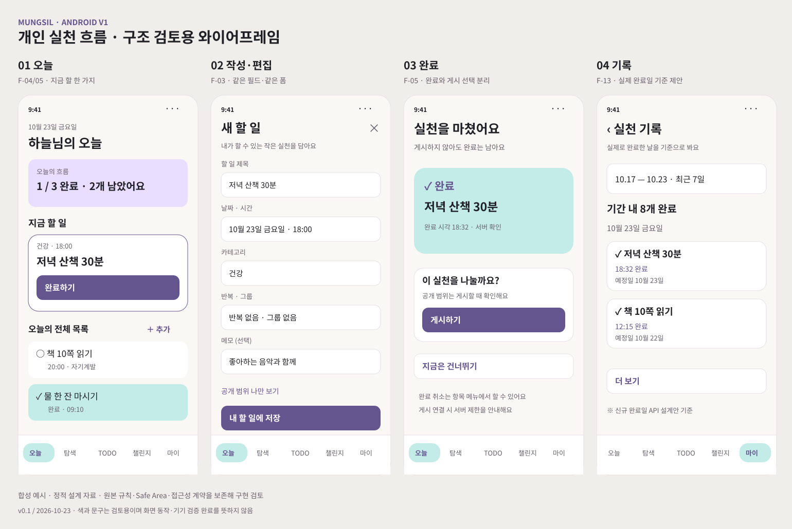
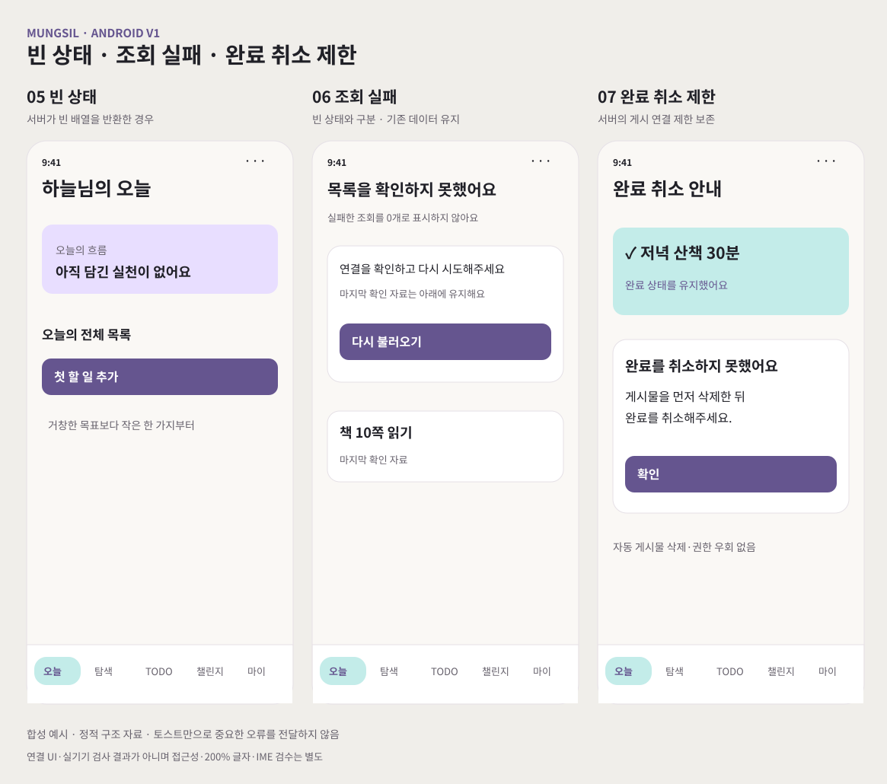

# Android V1 · 오늘부터 기록까지

2026-10-23 · v0.1 · **검토용 상세 설계 초안**

첫 구현 대상인 개인 실천 흐름을 화면·API·상태·검수 항목으로 구체화한 설계 자료입니다. 아래 설계 초안과 후속 구현 결과를 구분합니다.

| 자료 | 내용 |
| --- | --- |
| [M-09 공개 안전·권한/삭제 검증](implementation-m09.md) | 원본/상호작용 인가·쓰기 트랜잭션 보강, 실제 DB/저장소·탈퇴 파기 검증 |
| [응원·가져오기 설계](social-and-import-spec.md) · [M-08 구현·검증](implementation-m08.md) | 목록/상세의 응원 요청 공유·현재 상태 조회·루틴 초안/권한·재시도 |
| [선택적 게시 설계](publishing-spec.md) · [M-07 구현·검증](implementation-m07.md) | 계정별 게시/사진 초안·불확실한 결과 확인·명시적 공개 범위·완료 보존 |
| [M-06 연결·통합 검증 보고서](implementation-m06.md) · [재현 도구](../../../infra/verification/android-v1/README.md) | 실제 PostgreSQL/Redis/MinIO·API, API29 연결 UI와 폭/글자 검사, 환경 실패·남은 범위 |
| [M-05 구현·검증 보고서](implementation-m05.md) | 마이 내부 완료 기록·기간 선택·추가 조회·오류 복구·읽기 상세와 계정 경계 |
| [M-04 구현·검증 보고서](implementation-m04.md) · [기록 API 계약](history-api.md) | 실제 완료일 조회·본인 권한·서명 커서·total, 실제 PostgreSQL/HTTP 검사 |
| [M-03 구현·검증 보고서](implementation-m03.md) | 오늘의 정보 위계, 첫 조회/빈 목록/갱신 실패·처리 중 UI, 계정 날짜·목록 경계 |
| [M-02 구현·검증 보고서](implementation-m02.md) | 계정·대상별 폼과 제출 snapshot 복원, 결과 미확인 재시도·만료 처리, 현재 검사 결과 |
| [M-01 구현·검증 보고서](implementation-m01.md) | 완료·취소 서버 응답 반영, 실패 복구·늦은 응답·예약 조회의 실행 결과 |
| [화면 상세 명세](screen-spec.md) | 오늘, 공통 작성·편집, 완료·취소, 실제 완료일 기록, Android 상태·접근성 |
| [API·상태 계약](contracts-and-state.md) | 현행 API, 재시도/원복, 서버 시각, 완료 기록 API 추가 초안, 호환 경계 |
| [검수·구현 작업표](acceptance-and-tasks.md) | 요구사항 추적, 검수 시나리오 21개, 구현 묶음 M-01~09 |
| [화면 초안 원본](wireframes.svg) | 정상 흐름 4개 화면의 SVG |
| [상태 초안 원본](states.svg) | 빈 상태·조회 실패·완료 취소 제한 SVG |

## 주요 화면

## 예외 상태

## 최초 설계에서 확인한 경계와 후속 구현

| 구분 | 코드에서 확인한 사실 | 설계 반영 |
| --- | --- | --- |
| 예정일과 완료일 | GET /todos는 dueDate로 필터링 | M-04에서 completedAt 기준 GET /todos/history 별도 구현 |
| 완료 취소 제한 | 활성 게시 연결이 있으면 서버가 400 거부 | 완료 상태 원복·사유 안내, 게시물 자동 삭제 없음 |
| 성공 시각 | 최초 Android Repository는 완료 응답을 버리고 모델이 단말 시각 사용 | M-01에서 서버 응답 정규화 구현 |
| 초안 보존 | 그룹·반복 scope dirty 감지가 이미 존재 | 기존 보호 유지. 누락된 기능으로 오인해 재작성하지 않음 |

M-01 완료/취소, M-02 폼·제출 복원, M-03 오늘 화면, M-04 완료 기록 API, M-05 Android 완료 기록을 구현했고 M-06에서 실제 합성 서비스·Android 연결 검사를 수행했고 M-07에서는 기존 선택적 게시의 초안·결과 확인을 보강했습니다. M-07 연결 UI·시각/기기 검수는 미실행입니다. 기록의 기간·크기는 E-001의 개발 기본값을 사용합니다. 각 보고서의 실제 실행과 남은 범위를 구분하며 전체 설계·실기기/출시 검증·운영 배포 완료를 뜻하지 않습니다.

M-08은 응원·루틴 가져오기의 상태/화면 보강입니다. 현재 기기·실 DB 통합·만료된 불확실 응원의 서버 처리 조회는 후속 범위이며 [보고서](implementation-m08.md)에서 구분합니다.

M-09는 공개 서버의 권한·삭제 경계를 실제 HTTP/DB/저장소로 검증한 결과입니다. Android 화면/실기기·전체 운영 보안 검수 완료와 구분합니다.
