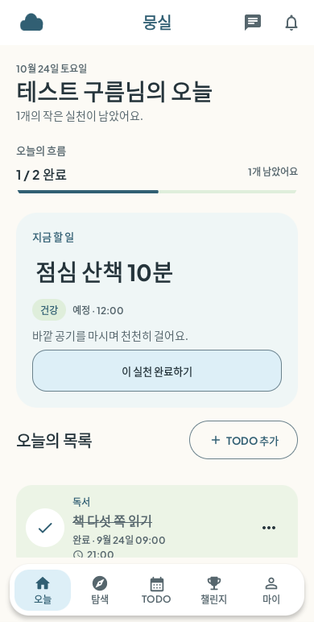
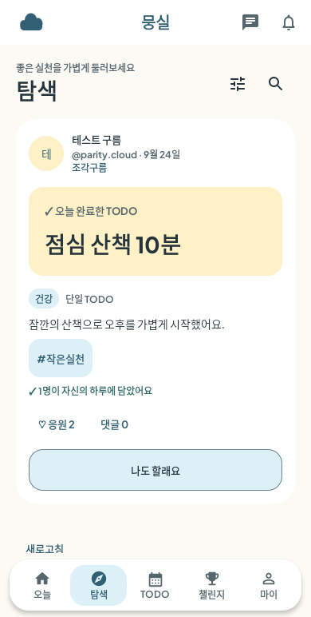
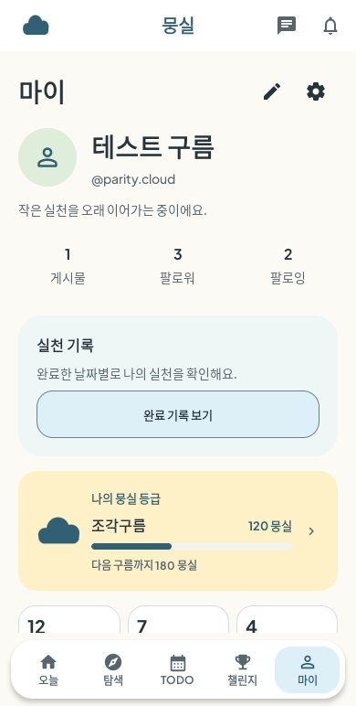

# Android · 연하늘·연초록·연노랑 시각 고도화

2026-10-24 (Asia/Seoul). 기준 `codex/beta-core`, 시작 `98a35b069d0c69c3af39194596ef7f3830e741c1`, 검증 제품/시험 소스 `1e7bda7b4661de97c08de1063d4551e582cf3f15`. 기존 시각 규격에서 벗어나더라도 차분한 매거진처럼 고도화하고 파스텔을 사용하자는 사용자 요청에 따른 첫 구현이다. [Android 시각 기준](../../design-system/android-pastel-editorial.md)을 공통 디자인 문서의 Android 예외로 연결했다. 웹의 기존 색상 구현·서버/API·데이터 정책은 변경하지 않았다.

## 변경

| 영역 | 적용 |
| --- | --- |
| 팔레트 | 아이보리 바탕, 연하늘 주요 행동/선택, 연초록 완료/실천, 연노랑 성취/등급/사진 없는 기록. 파스텔에는 짙은 글자·조작 경계 사용 |
| 오늘 | 진행 요약의 상자/테두리를 줄이고 현재 실천의 제목을 키움. 연하늘 색면과 주 행동을 중심으로 배치, 확인된 모두 완료는 연노랑으로 구분 |
| 탐색·게시물 | 사진은 카드 폭으로 넓게 표시, 사진 없는 기록은 고정4:3/장식 그라데이션 대신 내용 높이가 늘어나는 연노랑 영역. 중복 제목/등급 장식을 줄이고 반응과 전폭 가져오기 주 행동을 분리 |
| 마이 | 작은 프로필과 이름/소개·텍스트 수치, 바로 이어지는 완료 기록 진입. 등급은 연노랑 보조 카드, 통계의 큰 아이콘·프로필 장식·그림자 축소 |
| 공통 | 주 행동 최소52dp·짙은 글자/경계, 선택된 탭 연하늘, 태그 최소48dp·작은 모서리. 일반 정보 카드 경계와 조작 경계 구분 |

`Lavender/Aqua/Blush`는 새 브랜드 역할의 호환 별칭으로 유지한다. 사용자 카테고리의 기존 `aqua/blush/butter/lilac` 저장 값과 실제 색은 그대로 보존했다. 초안·사진 선택/업로드 상태·불확실 응원/게시·권한/계정 경계를 다시 만들거나 제거하지 않았다. 예시 사진/가짜 기록·외부 이미지/폰트·새 라이브러리를 제품에 넣지 않았다.

## 실제 화면

390dp의 같은 합성 계정/기록을 사용하는 원본이다. 실제 사용자 자료나 예시 사진을 제품 화면에 섞지 않았다.

| 오늘 | 탐색 | 마이 |
| --- | --- | --- |
|  |  |  |

| 추가 원본 | 오늘 | 탐색 | 마이 |
| --- | --- | --- | --- |
| 360dp | [보기](evidence/pastel-today-360.png) | [보기](evidence/pastel-explore-360.png) | [보기](evidence/pastel-me-360.png) |
| 430dp | [보기](evidence/pastel-today-430.png) | [보기](evidence/pastel-explore-430.png) | [보기](evidence/pastel-me-430.png) |

[모두 완료의 연노랑/연초록](evidence/pastel-completed-360.png) · [글자200%의 긴 제목](evidence/pastel-title-font200.png) · [글자200%의 긴 닉네임/소개](evidence/pastel-profile-font200.png). 마지막 이미지는 ProfileScreen 단독 Compose 시험이며 앱 셸 전체의 큰 글자 승인으로 확대하지 않는다. 제목/본문의 화면 위아래 이동은 실제 세로 스크롤이며 고정 높이로 원문을 숨기지 않는다.

대표12장을 직접 검토했다. 탐색의 대표 자료는 사진 없는 합성 게시물이다. 실제 사진의 전체 시각 검수나 모든 화면 승인을 주장하지 않는다. 단독 게시물 최소 fixture의 응원/터치 캡처는 전체 로그에 보존하고 대표 디자인 시안에는 포함하지 않았다.

## 검증

Android unit152/20 suites·Debug/시험 APK·lint 통과(오류0/경고32). root lint/test/build 통과, 격리 PostgreSQL/Redis/MinIO의 API160/Web53 모두 실패0/skip0. 실제 Google/FCM·서명/Play·운영 배포는 사용자 요청대로 보류하고 재시도하지 않았다.

본문/보조/브랜드 글자와 흰색/아이보리/세 파스텔15조합의 대비는 모두4.5:1 이상(최소4.94), 조작 경계와 흰색/아이보리/연하늘3조합은3:1 이상이다. `contrast.json`에 실제 sRGB 계산 결과를 보존한다. 장식용 경계·비활성 표시·사용자 지정 색상이나 모든 UI 조합의 접근성 승인을 의미하지 않는다.

새 AOSP API29 x86_64 AVD, 최초360×780/density160, RAM1536MiB/2cores/SwiftShader·소프트웨어 CPU, Docker10GiB. 부팅114.0초. 같은 소스로 앱/시험 APK를 함께 빌드·설치하고 두 패키지를 speed compile했다.

| 실제 실행 | 범위 | 결과 |
| --- | --- | --- |
| pastel360 | 공유 화면·오늘 상태/긴 글·그룹 조회 실패 보존·실제 IME 시트 | 4/4 통과 |
| pastel390 | 공유 화면 390×844dp | 1/1 통과 |
| pastel430 | 공유 화면 430×932dp | 1/1 통과 |
| pastel200 | 오늘 상태/긴 제목·마이 긴 콘텐츠/빈 기록/배지·목록/상세 미확인 응원 공유 | 3/3 통과 |
| pastel-cheer200 | 게시물 응원 실패/확인/새 행동, 공유/신고44dp | 1/1 통과 |

10회는 폭/글자 반복을 포함하는 기존7개 시험 메서드의 실행이며 새로운10개 고유 시나리오가 아니다. JUnit 기대/성공 건수·최종 코드와 OS ANR 없음을 확인했고 실패/skip은 없다. 컴파일 성공/기대 건수를 연결 통과로 취급하지 않았다. 모든 테스트를 기기에서 실행한 것은 아니다.

Debug APK24,650,350bytes/SHA256 `a8731f7b93f7374578de3ca6e9b411ac6dae87490125e7d5a6f6d7d4ce2ddc61`, 시험 APK1,377,780bytes/SHA256 `3e97092e384856228512f02fc8c598718bb404826747b2ba7e60342f512334c2`. `artifact-manifest.json`에 소스1e7bda7·해시·배포 없음/출시 서명 아님을 기록하고 실제 파일과 대조했다. 시험 코드가 그대로여서 시험 APK 해시는 UI-01과 같다. 과거 앱 APK를 최신 산출물로 취급하지 않는다.

## 범위와 다음 작업

이번은 오늘·탐색·마이의 첫 시각 고도화다. UI-02 탐색/가져오기의 전체 사용 흐름·UI-03 폼/시트·UI-04 챌린지/기록·UI-05 통합 검수를 완료로 바꾸지 않는다. 공통 테마가 적용되는 다른 화면도 전부 시각 승인한 것은 아니다.

현재 캡처는 합성 계정/기록으로 검증한 원본이다. 실제 사진/카메라/권한·실기기/TalkBack·전체 지원 OS·실제 프로세스 종료/복원·운영 연결/출시는 미검증이다. API29 OS 상태바의 글자200% 시계 잘림은 이전 이력과 같이 앱 영역 검수와 구분한다. GitHub Actions의 알려진 결제 제약은 조회/재실행·workflow 수정·결제 제안으로 조사하지 않는다.

원본 로그·APK·전체 캡처/대비 계산은 `/workspace/mungsil-setup/pastel-ui02`, root 로그는 `/workspace/mungsil-setup/pastel-ui02-services`에 보관한다. 재현은 [검증 안내](../../../infra/verification/android-v1/README.md)와 [matrix](../../../infra/verification/android-v1/device-matrix.json)의 pastel360/390/430/200을 사용한다. 실제 운영·사용자 자료나 인증 설정을 Git에 넣지 않는다.

종료 시 소유한 Android/PostgreSQL/Redis/MinIO 임시 컨테이너4개와 runtime credential 설정/state 제거를 확인했다. 기존 무관한 stopped 개발 컨테이너는 보존했다. `cleanup.json`·`visual-review.json`·`run-summary.json`에 실제 정리/선별 검토/실행 범위를 기록했고 운영 환경 변경·배포는 없다.
