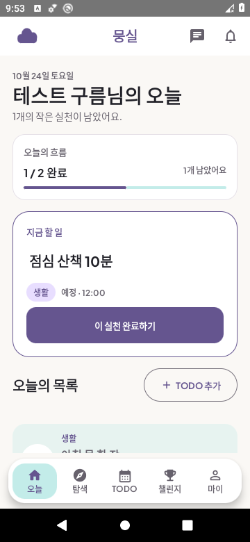
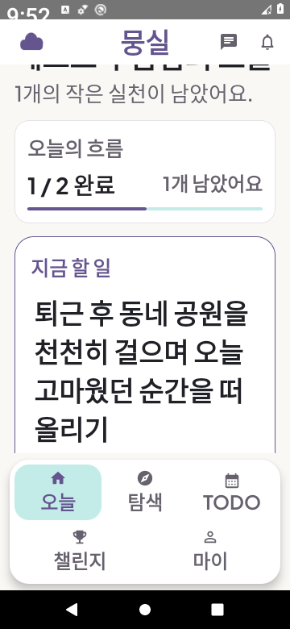
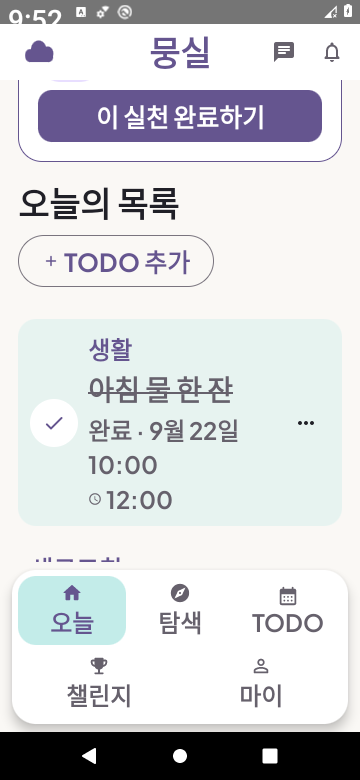

# UI-01 · 오늘·일정 화면의 정보 위계

2026-10-24 (Asia/Seoul). 기준 `codex/beta-core`, 시작 소스 `a56d5e40bf96d63df1805d3744232c8da23f194d`, 최종 제품·시험 소스 `0f5d4bb15f44e0a071fe95e186b1b18b7cb9f9b1`. 사용자 제공 설정을 기다리지 않고 진행하는 [화면 완성도 작업](ui-polish-plan.md)의 첫 묶음이다. 정식 출시·전체 화면 디자인 완료와 구분한다.

## 변경

| 영역 | 이전 | 변경 |
| --- | --- | --- |
| 오늘 진행 | 완료 수·남은 수가 세로로 반복되어 공간을 차지 | 수치를 한 행으로 묶고 큰 글자에서는 자연스럽게 줄바꿈. 진행 막대의 분리 간격/끝 장식을 제거하고 완료 수·변경 중 접근성 상태 제공 |
| 지금 할 일 | 굵은 테두리, 카테고리와 제목 사이 넓은 간격 | 얇은 브랜드 경계, 제목→카테고리/시각→설명→완료 순서. 제목 편집 터치 영역 최소48dp, 작은 모서리와 안쪽 여백으로 큰 글자의 다중 행 제목 clipping 방지. 화면의 주 행동은 완료 유지 |
| 오늘 목록 진입 | 제목과 추가 버튼이 별도 행 | 목록이 있으면 같은 행에 배치하고 큰 글자에서는 줄바꿈. 빈 목록은 전폭 추가 CTA 유지 |
| 일반/완료 항목 | 일반 항목도 브랜드 테두리로 강조, 완료는 넓은 진한 색면 | 일반 항목은 중립 경계, 완료는 옅은 aqua. 체크·완료 문구·시각·취소선도 유지해 색만으로 구분하지 않음 |

오늘·일정은 같은 항목 렌더링을 사용하므로 항목 경계/완료 색면은 일정에도 적용된다. 이번에는 API·공개 기본값·정책·초안·미확인 요청의 상태 처리·5탭·시트 구조를 변경하지 않았다. 외부 이미지·폰트·라이브러리 추가가 없다.

## 검증

Android `testDebugUnitTest`152개/20 suites, 실패0/skip0. 동일 제품 소스의 Debug·시험 APK 빌드, 최종 시험 소스의 APK 재빌드·lintDebug 통과. lint 오류0/경고32. root lint/test/build 통과, 격리 PostgreSQL/Redis/MinIO를 사용한 API160·Web53 모두 실패0/skip0.

연결 검사는 새 AOSP API29 x86_64 AVD, density160, 최초360×780, RAM1536MiB/2cores, SwiftShader/소프트웨어 CPU, 소유 label의 Docker10GiB 환경을 사용한다. 부팅133.7초, 앱/시험 APK를 함께 설치한다. 실제 Google·FCM·운영 데이터를 사용하지 않는다.

초기 APK는 speed, 최종 제목 수정 APK는 speed-profile로 package compile했다. 기기 준비와 시험 입력은 별도이며 assertion·timeout을 늘리거나 실패를 무시해 통과시키지 않았다.

기대 건수나 APK 컴파일 성공을 기기 통과로 취급하지 않는다. 최초200% 실행은 추가 버튼에 직접 `performScrollTo`한 뒤 가시성 assertion에서 실패했다. LazyColumn에서 항목을 먼저 찾도록 보완한 뒤 같은 가시성·44dp 검사를 통과했다. 이후 실제 캡처에서 긴 제목의 pill 모서리 글자 잘림을 발견해 제품 코드를 추가 수정했다. 첫 실패·동작 통과/시각 실패·최종 수정 후 결과를 구분한다. 첫 실패의 종료 후 OS 홈 이미지는 정상 제품 화면 증거가 아니다.

일정 카드의 공유 fixture 검사는 제목 모서리 수정 전 소스로360/390/430dp 각1개 통과했다. 일정은 `day.next == null`이므로 그 뒤 변경한 오늘의 제목 버튼은 렌더하지 않는다. 일정 카드 스타일과 관련 코드는 추가 변경하지 않았다. 이 단계의 공유 화면 통과를 최종 오늘의 긴 제목 검증으로 대신하지 않는다.

최종 제품·시험 소스0f5d4bb의 연결 결과:

| 실행 | 조건 | 실제 결과 |
| --- | --- | --- |
| ui01-360 | 360×780dp/100%, 화면 상태 + 조회 실패 보존 + 계정 분리 + 작성 재시도→완료→게시 | 4/4 통과 |
| ui01-390 | 390×844dp/100%, 정상·긴 글·모두 완료·빈 목록 | 1/1 통과 |
| ui01-430 | 430×932dp/100%, 같은 상태·행동 검사 | 1/1 통과 |
| ui01-200 | 360×780dp/200%, 제목·추가/완료 도달 및44dp 검사 | 1/1 통과, 제목/CTA 별도 캡처 직접 확인 |

모두 JUnit 기대/성공 건수·최종 코드와 실행 전후 OS ANR 없음을 확인했다. 최종7회는 같은 새 상태 시험의 폭/글자 반복과 기존3개 회귀를 포함하며7개의 새 고유 시나리오가 아니다. 앞선 shared360/390/430 각1개도 따로 보존한다. 기기에서 전체60개를 실행했다는 뜻이 아니다. 새 시험 추가로 재현 matrix의 suite360 기대값만59→60으로 바꿨고 M-11의 과거59개 실제 실행 결과는 그대로 둔다.

### 시각 증거

모든 이미지는 테스트 계정/합성 자료의 원본 PNG다. 보통 글자의 첫 화면 노출 기준은 짧은 제목의 완료 버튼과 목록 진입이다. 긴 제목과200% 글자는 단일 목록에서 실제 스크롤해 제목과 각 행동에 접근하는지 검사하며 모두를 첫 화면에 고정하지 않는다.

[390dp 오늘](evidence/ui01-today-390.png) · [430dp 오늘](evidence/ui01-today-430.png) · [모두 완료](evidence/ui01-completed-360.png) · [확인된 빈 목록](evidence/ui01-empty-360.png)

일정 캡처: [360dp](evidence/ui01-schedule-360.png) · [390dp](evidence/ui01-schedule-390.png) · [430dp](evidence/ui01-schedule-430.png). 제목 버튼 수정 전, 일정 렌더링은 이후 동일하다. OS 상태바 시계의200% 잘림은 이전 M-11과 같이 남아 있고 앱 영역의 glyph clipping 수정과 구분한다. 스크롤로 화면 위/아래에 나간 콘텐츠를 고정 높이로 잘라 숨기지 않는다.

## 재현·제한

새 AVD·동일 소스 앱/시험 APK 준비는 [검증 도구 안내](../../../infra/verification/android-v1/README.md)를 따른다. 새 시험은 `kr.kro.mungsil.NativeFlowTest#todayHierarchyKeepsActionsReachableAcrossContentStates`이다. 실제 앱 셸 안에서 보통 글자 첫 화면의 완료/목록 진입, 긴 제목·설명의 CTA 접근/44dp, 모두 완료와 빈 목록의 구분, 조회만 발생하는지를 검사한다. 오류·계정 경계·작성 실패/같은 키 재시도→완료→게시의 기존 시험도 유지한다.

최종 케이스는 [device-matrix.json](../../../infra/verification/android-v1/device-matrix.json)의 ui01-360/390/430/200으로 재현한다. 예: `python infra/verification/android-v1/connected.py WORK ui01-200 'kr.kro.mungsil.NativeFlowTest#todayHierarchyKeepsActionsReachableAcrossContentStates' 1 360 780 2.0`. WORK는 새 소유 에뮬레이터의 작업 폴더로 바꾸며 과거 로그를 덮어쓰지 않는다.

원본 로그·APK·전체 캡처는 `/workspace/mungsil-setup/today-polish`, root 로그는 `/workspace/mungsil-setup/today-polish-services`에 보관한다. 인증 설정·APK·운영 자료는 Git에 넣지 않는다. 실제 TalkBack·실기기·OS 프로세스 종료/복원·전체 지원 OS·모든 화면 IME 검수는 이번 범위가 아니다. Google/FCM·서명/Play·운영 배포는 사용자 요청대로 보류하며 Actions는 조회/재실행하지 않았다.

최종 Debug APK는24,652,185bytes/SHA256 `b7e5a27d3b62a5460c2e55eaa8aaf166d7256a7c461742e6b652048d2acdb199`, 시험 APK는1,377,780bytes/SHA256 `3e97092e384856228512f02fc8c598718bb404826747b2ba7e60342f512334c2`다. `artifact-manifest.json`에 소스0f5d4bb·크기·해시·배포 없음/출시 서명 아님을 기록하고 실제 파일과 대조했다. M-12의 과거 APK 해시는 이 UI 수정 산출물의 해시가 아니다. Release 빌드는 이번에 재시도하지 않았다.

종료 시 소유한 임시 Android·PostgreSQL·Redis·MinIO 컨테이너4개와 runtime credential 설정/state 제거를 확인했다. `cleanup.json`·`visual-review.json`에 정리와 대표 원본10장 직접 검토 범위를 기록했다. 로그·합성 검토 자료·SDK는 checkout 밖에 보존하며 운영 환경 변경/배포는 없다.

다음 순서는 UI-02 탐색·게시물·가져오기다.
