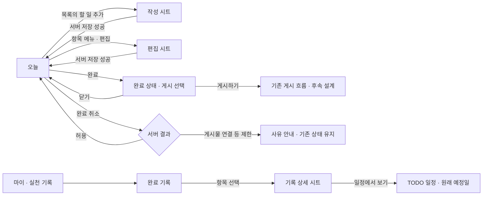

# Android V1 · 개인 실천 상세 설계

문서 ID: AND-V1-UX-001 · v0.1 · 2026-10-23 (Asia/Seoul)

상태: **검토용 상세 설계 초안**. 기준 소스: `codex/beta-core@887fdef`.

사용자가 확정한 것은 Android 우선과 재설계 착수다. 아래 화면·이름·기록 기준은 이번 설계안이며 사용자 승인 완료나 앱 구현 완료를 뜻하지 않는다. 기존 개인정보·권한 규칙과 5탭을 유지한다.

- [화면 초안](wireframes.svg) · [상태 초안](states.svg)
- [API·상태 계약](contracts-and-state.md) · [검수·구현 작업](acceptance-and-tasks.md)

## 1. 이번 설계의 사용자와 범위

| 항목 | 설계 가정·범위 | 근거·한계 |
| --- | --- | --- |
| 대표 상황 | 출근 전·점심·저녁에 앱을 열어 다음 작은 실천을 보고, 짧게 기록하는 사용자 | 현재 제품 방향에 근거한 가설. 사용자 조사 완료 아님 |
| 핵심 사용자 과업 | 오늘 남은 일을 파악하고, 할 일을 추가하고, 완료·취소하며 자신의 기록을 확인 | F-03~05/13 |
| 성공 경험 | 앱을 열면 다음 행동이 보이고, 저장·완료 결과를 믿을 수 있다 | N-01/03 |
| 첫 범위 | 오늘 목록, 공통 작성·편집 폼, 완료·취소, 개인 완료 기록 | 계정·API·기존 반복/그룹/분류는 재사용·호환 검토 |
| 후속 연결 | 완료 이후 선택적 게시, 탐색과 가져오기 | 이번에는 연결 지점만 정의. 게시/파기 정책을 새로 확정하지 않음 |
| 범위 밖 | 새 점수·랭킹·보상, 새 채팅·챌린지, 오프라인 자동 동기화, 운영 배포 | 기존 기능 삭제 또는 사용 중단을 의미하지 않음 |

## 2. 화면 이동

기록은 마이 내부 경로로 제안하며 여섯 번째 탭을 추가하지 않는다. 오늘·탐색·TODO·챌린지·마이의 기존 탭과 다른 기능 진입점을 유지한다.

## 3. S-01 오늘

| 순서 | 표시·행동 | 상세 규칙 |
| --- | --- | --- |
| 1 | 계정 시간대의 날짜와 짧은 인사 | 앱 복귀·자정·계정 시간대 변경 때 오늘을 재계산. 날짜가 바뀌어도 미저장 폼을 초기화하지 않음 |
| 2 | 진행 요약 | `완료 1 / 전체 3`, `2개 남았어요`. 서버 확인 수치와 처리 중 상태를 구분. 조회 실패를 0개로 표시하지 않음 |
| 3 | 지금 할 일 | 오늘의 미완료 항목 중 `dueDate, id` 기준 첫 항목을 제안. 가장 강한 행동은 `완료하기` 하나 |
| 4 | 오늘의 전체 목록 | 지금 카드에 보인 항목은 중복 렌더링하지 않음. 단일 목록에서 나머지 예정·완료 표시 |
| 5 | 목록 헤더의 할 일 추가 | 추가 진입점은 한 곳. 현재 카드가 있으면 보조 버튼. 빈 상태에서는 같은 위치의 주 행동으로 승격 |
| 6 | 완료 항목 | 체크+`완료` 텍스트와 실제 완료 시각. 색·취소선만으로 구분하지 않음. 메뉴에 편집·완료 취소·기록 게시 |
| 7 | 그룹 | 기존 소속 유지. 오늘의 접힌 그룹도 이름·완료 수·다음 할 일을 표시. 소속 조회 실패 시 기존 관계를 임의 변경하지 않음 |

| 상태 | 사용자에게 보이는 내용 | 가능한 행동 |
| --- | --- | --- |
| 처음 조회 | 목록 형태의 로딩 표시 | 조회 완료 대기. 미확인 수치·완료 버튼 노출 안 함 |
| 아직 할 일 없음 | `오늘은 아직 담긴 실천이 없어요` | 목록 헤더의 `할 일 추가` |
| 전부 완료 | `오늘 담은 실천을 모두 마쳤어요`와 완료 목록 | 기존 완료 메뉴, 필요할 때 추가. 자동으로 다른 화면 이동 안 함 |
| 기존 데이터 재조회 | 기존 목록 유지 + 갱신 표시 | 중복 쓰기 제어. 응답이 오면 현재 날짜·계정인지 검사 |
| 목록 조회 실패 | 오류 문구와 `다시 불러오기` | 이전 자료가 있으면 마지막 확인 자료임을 표시. 조회 실패를 빈 상태로 바꾸지 않음 |
| 그룹만 조회 실패 | 할 일 목록은 표시 + `그룹을 확인하지 못했어요` | 그룹 재시도. 현재 소속을 빈 그룹으로 저장하지 않음 |
| 오프라인 | 기존 자료가 있으면 마지막 확인 자료, 없으면 연결 안내 | 자동 쓰기 큐 없음. 불확실한 성공을 완료로 확정하지 않음 |

## 4. S-02 작성·편집 · 같은 폼

`NativeSheet`를 사용한다. 제목과 닫기를 고정하고 본문만 스크롤한다. CTA는 키보드와 Safe Area를 고려한 문서 흐름의 하단 영역에 둔다. 웹 문서의 공통 폼 계약과 용어를 맞춘다.

| 순서 | 필드 | 초기값·검증 | 편집 시 보존 |
| --- | --- | --- | --- |
| 1 | 할 일 제목 | 앞뒤 공백 제거 뒤 1~120자. 보이는 레이블·입력 길이 안내. 공백만 입력 금지 | 원래 제목. 한글·이모지 경계는 서버 검증과 맞춰 시험 |
| 2 | 날짜·시간 | 최초에는 진입 날짜와 현행 기본 시간 09:00 사용. 필수 `dueDate` 때문에 시간 없는 일정은 이번에 새로 도입하지 않음 | 사용자가 날짜/시간을 바꾸지 않으면 원본 초·밀리초까지 보존 |
| 3 | 카테고리 | 기본 생활, 사용자 카테고리 조회·재시도 | 조회 미완료/실패 시 기존 ID·이름을 임의로 초기화하지 않음 |
| 4 | 반복 | 새 항목은 반복 없음. 기존 기능의 선택과 원본 규칙 유지 | 복잡한 기존 규칙도 그대로 보존. 반복 수정은 이번만/이후 범위를 명시 |
| 5 | 그룹 | 새 항목은 그룹 없음. 그룹 선택은 보조 필드 | 조회 실패 시 기존 소속을 해제하지 않음 |
| 6 | 메모 | 선택, 최대 500자 | 공백 정리·비우기 의미와 서버 허용값 확인 |
| 7 | 공개 범위 | 새 개인 TODO는 현행 PRIVATE 기본값을 유지. 게시 공개 범위와 별개로 설명 | 기존 PUBLIC/FOLLOWERS/PRIVATE를 보존. 편집을 이유로 비공개 전환하지 않음 |
| 8 | 저장 | 새 항목은 `내 할 일에 저장`, 편집은 `변경 저장` | 유효·변경 여부와 제출 상태를 함께 판단 |

09:00 기본값은 현행 동작 보존을 위한 초안이며 ‘현재 시각/마지막 선택’ 정책은 검토 대상이다. 반복·그룹·공개 옵션을 시각적으로 보조 배치할 수 있지만, 기존 값을 숨긴 채 재저장해 소실시키지 않는다.

| 사건 | 처리·사용자 안내 |
| --- | --- |
| 유효하지 않은 제목·날짜 | 해당 필드 아래 오류. 다른 입력 유지. 첫 오류 필드로 포커스 이동 |
| 저장 중 | 중복 탭 차단·`저장 중…`. 요청 본문 snapshot과 키 유지 |
| 확실한 저장 실패 | 시트를 닫지 않고 입력·요청 키를 보존. 원인과 재시도 제공 |
| 응답 유실·timeout | `저장 결과를 확인하지 못했어요`. 동일 요청 키로 결과 확인·재시도. 즉시 새 키로 같은 항목 생성 금지 |
| 성공 | 서버 항목으로 목록 갱신 후 닫기. 날짜를 옮긴 편집이면 해당 일정으로 이동할 수 있는 안내 제공 |
| 변경 없이 닫기 | 즉시 닫기 |
| 미저장 변경 상태에서 뒤로 가기·닫기·바깥 탭 | 공통 확인 시트로 `계속 작성` / `변경 버리기`. 제목뿐 아니라 그룹·공개·반복 변경도 dirty 비교에 포함 |
| 저장 중 닫기·프로세스 재생성 | 요청 식별자와 입력 복원 후 상태 확인. 화면 이탈을 서버 취소로 간주하지 않음 |
| 계정 전환·로그아웃 | 이전 계정 목록과 요청 응답을 새 계정에 반영하지 않음. 초안은 계정 범위를 확인해 정리하고 다른 계정에 노출하지 않음 |

## 5. S-03 완료·취소

| 행동 | 설계 규칙 | 현행 서버와의 관계 |
| --- | --- | --- |
| 완료 | 즉시 처리 중 표시. 낙관적 체크는 허용하되 성공 확정·완료 시각은 서버 응답으로 정규화 | `POST /todos/:id/complete`, body `{share:false}`, 응답의 `todo` 사용 |
| 완료 성공 | 완료 상태와 취소 진입점 유지. 짧은 피드백 뒤 게시 선택은 건너뛸 수 있음 | 게시 시트를 닫아도 완료 유지 |
| 완료 실패 | 원래 항목·진행 수 복원, 실패·재시도 표시 | 같은 시도 재시도는 같은 키. 성공 이후 새 행동은 새 키 |
| 완료 취소 | 처리 중·낙관 상태를 구분하고 서버 결과로 확정 | 현재 게시물이 연결돼 있으면 서버가 400으로 거부 |
| 취소 제한 | `게시물을 먼저 삭제한 뒤 완료를 취소해주세요`를 보여주고 완료 상태 유지 | 게시물·미디어를 자동 삭제하거나 제한을 우회하지 않음 |
| 다중 탭·늦은 응답 | 처리 중 해당 변경 중복 방지. 다른 날짜/계정의 늦은 응답으로 현재 목록 덮지 않음 | 처음 구현은 현행 전역 쓰기 잠금을 유지해 동시성 확대를 별도 작업으로 분리 |

점수·연속 기록·보상 정책은 변경하지 않는다. 완료 취소 후 점수가 자동 회수된다고 새로 설명하지 않는다. 점수보다 ‘실천 완료’에 피드백의 중심을 둔다.

## 6. S-04 완료 기록

**기록의 날짜는 실제 `completedAt` 기준**으로 개발한다. 예정일 목록과 완료 기록을 구분한다. 후속 M-04에서 [기록 API](history-api.md), M-05에서 [Android 기록 화면](implementation-m05.md)을 구현했다. 아래는 설계 기준이며 실제 실행/미검증 범위는 보고서에서 구분한다. 기간·페이지 크기는 E-001의 개발 기본값이며 별도의 사용자 확정 발언을 뜻하지 않는다.

| 요소 | 규칙 |
| --- | --- |
| 진입 | 마이의 `실천 기록` 보조 진입점. 별도 최상위 탭 추가 없음 |
| 기간 | 기본 최근 7개 계정 현지 날짜(오늘 포함), 날짜 범위를 명시하고 변경 가능 |
| 목록 | 실제 완료일별 그룹, 완료 시각 최신순, 동일 시각 ID 보조 정렬. 제목·완료 시각·원래 예정일 표시 |
| 수치 | 기간 합계는 서버 total 확인 뒤 표시. 내려받은 첫 페이지 길이를 전체 건수로 표시하지 않음 |
| 더 보기 | 커서 기반 추가 조회, 중복 ID 제거. 추가 조회 실패 때 기존 항목 유지·해당 위치 재시도 |
| 상세 | 읽기 중심 시트: 제목·메모·완료 시각·예정일·반복·공개 정보. `일정에서 보기`는 기록의 서버 시간대와 원래 예정일로 이동 |
| 삭제·취소 후 | 목록 재조회, 취소된 항목은 완료 기록에서 제외. 이력 장부·삭제된 항목 영구 보관을 새로 만들지 않음 |
| 의미 | 현재 완료 상태의 조회이며 과거 모든 완료/취소 이벤트의 불변 감사 기록이 아님 |
| 권한 | 본인의 미삭제 항목만. 비공개 메모·다른 계정 기록은 노출하지 않음 |

예: 10월 22일 예정 항목을 23일에 완료하면 23일 기록에 표시한다. 23일 완료를 취소하면 현재 완료 기록에서 빠진다. 새 API 없이 예정일 목록을 필터링한 결과는 ‘해당 일정의 완료 항목’으로만 표시할 수 있으며, 완료일 기록의 구현으로 인정하지 않는다.

## 7. 공통 Android 계약

| 항목 | 구현·검수 기준 |
| --- | --- |
| 내비게이션 | Android 뒤로 가기는 열린 picker→시트/dirty 확인→이전 화면 순서. 기존 5탭과 화면 상태 보존 |
| 스크롤 | 기본 화면은 단일 LazyColumn. 시트 본문 스크롤과 고정 헤더/CTA의 소유권 분리. 중첩 스크롤·고정 높이 잘림 방지 |
| 터치·이름 | 최소 48dp를 이번 Android 목표로 제안(현행 최솟값 44 이상). 체크·메뉴·닫기의 한국어 접근성 이름과 상태 제공 |
| 글자·키보드 | 레이블은 입력 위, 200% 글자 확대와 IME 열린 상태에서 입력·저장 버튼에 도달 가능 |
| 상태 알림 | 완료/처리 중/실패를 색 외 텍스트·체크·접근성 상태로 전달. 중요 오류는 토스트만으로 끝내지 않음 |
| 복원 | 날짜·초안·반복 raw·그룹 선택·공개·dirty 기준·요청 snapshot/키를 계정 범위에서 복원 |
| 개인정보 | 작성 본문·키·토큰을 로그에 남기지 않음. 예시 화면 데이터는 문서 전용 합성 자료 |

## 8. 합의가 필요한 항목과 진행 가능 범위

| 의제 | 이번 권장안 | 확정 전 처리 |
| --- | --- | --- |
| 기록 날짜의 의미 | 실제 완료일 | E-001 개발 기준으로 M-04 API·M-05 Android 구현. 예정일 API로 대체하지 않음 |
| 완료 이후 게시 노출 | 명시적 선택, 건너뛰어도 완료 유지 | 기존 선택적 게시 흐름 보존. 강제 게시·자동 공개 없음 |
| 첫 진입 날짜/시간 | 계정 시간대의 오늘·09:00 | 현행 동작 보존. 새 시간 없는 일정은 별도 설계 |
| API 기록 기간·크기 | 1~90일, 페이지 기본 20·최대 50 | M-04 개발 기본값. 제품 검토·운영 규모의 성능/사용성 확인 때 조정 가능 |

현재 확정된 기술·보안 계약을 유지하는 화면 상태·서버 응답 정규화·초안 복구 작업은 별도로 착수 가능하다. 새 정책은 결정 로그에서 제안과 확정을 구분한다.
